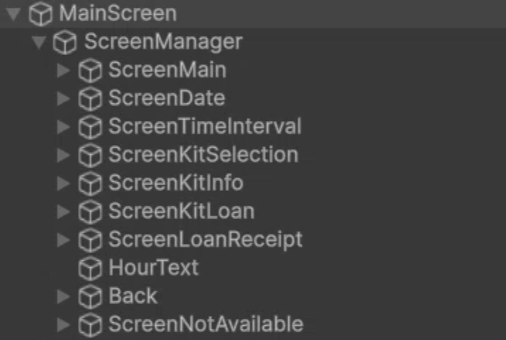

**HCI AI usage**

Bruno Palacios Cacho 12:25 p.m. \- DeepSeek  
11/10/2026

**Prompt:**   
Based on this scene structure, and this enum of the screen types, give me a MonoBehaviour script that includes 2 things:

1.- Make a serializable struct that allows me to add the screen type to the screen Game Object and the GameObject itself of the screen. Save each screen on an array of said structure.

2- A method that allows to switch between screens on an onClick() button, hiding everyOther screen and showing the target screen. Make the target screen a parameter of the method.

**Script attached:**  
public enum ScreenType  
{  
    ScreenMain,  
    ScreenDate,  
    ScreenTimeInterval,  
    ScreenKitSelection,  
    ScreenKitInfo,  
    ScreenKitLoan,  
    ScreenLoanReceipt,  
    ScreenNotAvailable  
}

**Image Attached:**  


**Purpose:** Set-up basic navigation logic between screens to further add functionality to each of the screens.

**Response:**  
Here is the `MonoBehaviour` script that fulfills your requirements.

I have included the serializable struct, the array to hold your screens, and the method to switch between them. I also added a small wrapper method (`SwitchScreenByIndex`) because Unity's default `Button.onClick` inspector cannot directly pass an `enum` value (like `ScreenType`); it can only pass an `int`, `string`, `float`, or `bool`.

using UnityEngine;

public class ScreenManager : MonoBehaviour

{

    // 1\. Serializable struct to map the ScreenType to a GameObject

    \[System.Serializable\]

    public struct ScreenEntry

    {

        public ScreenType type;

        public GameObject screenObject;

    }

    // Array to hold all your screens

    \[SerializeField\] private ScreenEntry\[\] screens;

    private void Start()

    {

        // Optional: Initialize by showing the main screen at start

        SwitchScreen(ScreenType.ScreenMain);

    }

    // 2\. Method that switches between screens

    public void SwitchScreen(ScreenType targetScreen)

    {

        bool targetFound \= false;

        foreach (var screen in screens)

        {

            if (screen.screenObject \== null) continue;

            // If this is the target screen, show it and mark that we found it

            if (screen.type \== targetScreen)

            {

                screen.screenObject.SetActive(true);

                targetFound \= true;

            }

            // Otherwise, hide it

            else

            {

                screen.screenObject.SetActive(false);

            }

        }

        if (\!targetFound)

        {

            Debug.LogWarning(\$"\[ScreenManager\] Target screen '{targetScreen}' was not found in the screens array.");

        }

    }

    // Wrapper method for Unity UI Button onClick()

    // Unity's default Inspector requires an int parameter for dropdowns

    public void SwitchScreenByIndex(int index)

    {

        if (index \>= 0 && index \< screens.Length)

        {

            SwitchScreen(screens\[index\].type);

        }

        else

        {

            Debug.LogError(\$"\[ScreenManager\] Invalid screen index: {index}");

        }

    }

}

**Testing:**

The script was added to most of the NEXT buttons on the screens to test if the index matched with the intended screens. This logic would be the same used to actually travel to previous and following screens.

**How it works:**

Based on the Screen Type, it stores an array of the struct of ScreenEntry. Each element matches a GameObject to a ScreenType. The method SwitchScreenByIndex activates the corresponding element on the array that is specified as a parameter of the function.

Bruno Palacios Cacho. \- Claude  
12/10/2026 01:07 p.m.

**Prompt:**

Taking this navigation script as a reference as how the navigation works in this project, the ScreenDate has the following structure: 

The calendar is an empty game object with a grid component, with a button prefab that has the day number as a TMP text. 

The time selections are 2 vertical scroll views that should serve as a 24 hour clock, with the hours on the left/first scroll view, and the minutes in 30 minute intervals on the right, meaning 00 or 30 only.

I want a monobehaviour script that allows me to save/do the following things:

First, make an array of the button prefabs for the calendar that displays exactly 14 elements at a time based on a starting date value, for example, if I set the starting date value at October 10th, it should show the days starting from the week October 10th is, and the following week only, the starting date has to be obtained from the device the program is running from.

Second, in the scroll menus, I want to have an array of 12 elements for the hours and only 2 elements on the minutes menus. The 14 elements on the hours should be starting from 06 all the way to 19\. The 2 elements on the minutes should be 00 and 30\. The elements should be displayed as button elements as an array. The program needs to have a lock that checks the current hour when the program is running from the device, and disable the hour buttons previous to the time the program is running.

Based on the previous things, I also want to create a structure that saves both the day selected in the calendar (meaning the day button that was clicked), and the time that was selected in the scroll menu. Since there is a NEXT button at the bottom of the screen, it should be disabled UNTIL the date and time has been selected. The structure also needs to have 2 more attributes, which are the kit number as an Integer, and the time interval, also as an integer.

The structure object needs to be stored externally in an external file, that can be accessed from any screen and not only from the ScreenDate part, and needs to be able to be modified from any screen.

**Response:**

I made three scripts. Drop them in `Assets/Scripts/UIManager` next to your ScreenManager.

* **`ScreenDateController.cs`** goes on the `ScreenDate` object. It builds the 14 day buttons, the hour buttons and the 2 minute buttons, and runs the locks.  
* **`BookingData.cs`** is the structure: day, time, kit number and time interval.  
* **`BookingStore.cs`** is a static class that holds the one shared `BookingData`. It isn’t tied to any screen, so it survives screen switches.

**Reading and writing the data from any screen**

csharp

```c#
BookingStore.Data.kitNumber = 3;
BookingStore.Data.timeInterval = 30;
BookingStore.NotifyChanged();       // so any screen listening refreshes

if (BookingStore.Data.HasDateAndTime) { ... }
```

`BookingStore.Save()` and `Load()` also write it to a JSON file in `persistentDataPath`. It’s optional, and I’d only call `Load()` deliberately, otherwise a kiosk could start with someone’s old booking.

**Where I deviated from your spec**

* **12 vs 14 hours:** you wrote 12 elements, but 06 to 19 is 14\. I followed the range, and `firstHour` and `lastHour` are in the inspector if you want to change it.  
* **Class instead of struct:** `BookingData` is a class, not a struct. A struct in a static store gets copied every time you touch it, which causes silent “my change didn’t save” bugs. The date and time are stored as ints because `JsonUtility` can’t serialize `DateTime`.  
* **Week start:** “the week October 10th is” depends on whether weeks start Monday or Sunday. I defaulted to Monday, and `firstDayOfWeek` is in the inspector.  
* **Past days:** days earlier than today in the first week are disabled, which you didn’t ask for (`disablePastDays` turns it off). I also disable a minute button that has already passed during the current hour, so at 10:45 you can’t pick 10:00 (`lockPastMinutes` turns it off).  
* **Hour lock:** the hour lock only applies when the selected day is today. Future days have every hour enabled.  
* **Next button:** “time selected” means both hour and minute are chosen.

**Setup in the Inspector**

1. On `CalendarGrid`, set the `GridLayoutGroup` to a fixed column count of 7\. That gives 2 rows of 7\.  
2. Delete the `DayButton` sitting in the hierarchy under `CalendarGrid`. The script instantiates its own 14, so that one would make it 15\. Assign the prefab asset from the Project window instead.  
3. Create a small button prefab with a TMP text child for the hours and minutes. Assign it to `timeButtonPrefab`.  
4. Put a `VerticalLayoutGroup` and a `ContentSizeFitter` (vertical fit set to Preferred) on both scroll view Content objects.  
5. Wire the `Next` button’s onClick to `ScreenManager.SwitchScreenByIndex` yourself. The script only controls whether it’s interactable.

For testing, `useDebugNow` and `debugNow` fake the clock (for example `2026-10-10 08:15`) so you can check the locks without waiting for the hour to change. Turn it off before building.

**How it works:**

The BookingData is the model file for a booking, meaning every single booking uses this. It stores the selected date (year, month and day), the selected time (hour and minute), the kit number and the time interval in minutes. 

The BookingStore stores the current booking that is being done actively, and can save it to the reservations. It also stores the confirmed bookings onto a reservations.json. 

The ScreenDateController controls the date and time selection from each booking. The UI is built dynamically based on a dayButton Prefab and a time button prefab. It only builds 14 days at a time, based on the day the manager is being ran. It displays the week of the date and the following week. It disables previous days and on the same day it disables hours and minutes that have already passed. When any of these buttons is pressed (day, hour or minute), it writes to the BookingStore.Data, which is the information of the current Booking that is being built. 

Bruno Palacios Cacho 02:09 p.m. \- Claude  
12/10/2026

**Prompt:**

For the [ScreenTimeIntervalController.cs](http://ScreenTimeIntervalController.cs), I need a script where based on the BookingData and BookingStore, the timeInterval is stored depending on the button pressed, where only these 4 options are present as individual buttons: 30, 60, 90 or 120 minutes. The method needs to read the tag of each button that is pressed (30m, 60m, 90m or 120m). Based on this tag, it should save the time interval to the TimeInterval attribute. The NEXT button should be disabled until the user selects one of the time intervals.

**Response:** 

I wrote `ScreenTimeIntervalController.cs`. Put it on the `ScreenTimeInterval` object. It uses the same `BookingStore` pattern as the date screen, so you don’t need to change `BookingData` or `BookingStore`.

**What it does**

* Clicking a button reads that button’s tag, strips the `m` and stores the number in `BookingStore.Data.timeInterval`, then calls `NotifyChanged()`.  
* Only 30, 60, 90 and 120 are accepted. A button with any other tag logs a warning in the Console and does nothing.  
* `Next` stays disabled until `timeInterval` is one of the 4 valid values.  
* The selected button is highlighted, using the same yellow as the date screen. If the user goes Back and returns, the highlight is restored from the stored value.

**Setup in Unity**

1. **Create the tags.** Select any object → Tag dropdown → `Add Tag...` and create `30m`, `60m`, `90m` and `120m`. Unity won’t let you assign a tag that doesn’t exist yet.  
2. **Assign one tag to each button.** Select the button GameObject, not its text child, and set its Tag to match.  
3. **Fill in the controller.** Drag the 4 buttons into `Interval Buttons` and your Next button into `Next Button`.  
4. **Wire Next.** Set its onClick to `ScreenManager.SwitchScreenByIndex` with the index of `ScreenKitSelection` in your ScreenManager’s `screens` array.

**Check before testing**  
 Make sure each button’s Image is the `Target Graphic` on the Button component. The highlight tints that image, and if it’s empty nothing will change color.

using System;  
using UnityEngine;  
using UnityEngine.UI;

/// \<summary\>  
/// Put this on the ScreenTimeInterval GameObject.  
/// Each interval button carries a Unity Tag ("30m", "60m", "90m", "120m").  
/// Clicking a button reads its tag, converts it to minutes and stores it in BookingStore.Data.timeInterval.  
/// Next stays disabled until one of the 4 intervals is selected.  
/// \</summary\>  
public class ScreenTimeIntervalController : MonoBehaviour  
{  
    private static readonly int\[\] ValidIntervals \= { 30, 60, 90, 120 };

    \[Header("Buttons (one per interval, each tagged 30m / 60m / 90m / 120m)")\]  
    \[SerializeField\] private Button\[\] intervalButtons;

    \[Header("Navigation")\]  
    \[SerializeField\] private Button nextButton;

    \[Header("Selection look")\]  
    \[SerializeField\] private Color normalColor \= Color.white;  
    \[SerializeField\] private Color selectedColor \= new Color(1f, 0.9f, 0f);

    private bool listenersAdded;

    // \---------------------------------------------------------------- lifecycle

    private void OnEnable()  
    {  
        AddListenersOnce();  
        BookingStore.Changed \+= Refresh;  
        Refresh(); // restores the highlight if the user comes back with the Back button  
    }

    private void OnDisable()  
    {  
        BookingStore.Changed \-= Refresh;  
    }

    private void AddListenersOnce()  
    {  
        if (listenersAdded) return;  
        listenersAdded \= true;

        foreach (Button button in intervalButtons)  
        {  
            if (button \== null) continue;  
            Button captured \= button;  
            captured.onClick.AddListener(() \=\> OnIntervalClicked(captured));  
        }  
    }

    // \---------------------------------------------------------------- click

    private void OnIntervalClicked(Button button)  
    {  
        string tag \= button.gameObject.tag;

        if (\!TryParseTag(tag, out int minutes))  
        {  
            Debug.LogWarning(\$"\[ScreenTimeInterval\] Button '{button.name}' has tag '{tag}', expected 30m, 60m, 90m or 120m.");  
            return;  
        }

        BookingStore.Data.timeInterval \= minutes;  
        BookingStore.NotifyChanged();  
    }

    // \---------------------------------------------------------------- refresh

    private void Refresh()  
    {  
        int selected \= BookingStore.Data.timeInterval;

        foreach (Button button in intervalButtons)  
        {  
            if (button \== null || button.image \== null) continue;

            bool isSelected \= TryParseTag(button.gameObject.tag, out int minutes) && minutes \== selected;  
            button.image.color \= isSelected ? selectedColor : normalColor;  
        }

        if (nextButton \!= null)  
            nextButton.interactable \= Array.IndexOf(ValidIntervals, selected) \>= 0;  
    }

    // \---------------------------------------------------------------- helpers

    /// \<summary\>"90m" \-\> 90\. Returns false if the tag isn't one of the 4 valid options.\</summary\>  
    private static bool TryParseTag(string tag, out int minutes)  
    {  
        minutes \= \-1;  
        if (string.IsNullOrEmpty(tag)) return false;

        string digits \= tag.TrimEnd('m', 'M');  
        if (\!int.TryParse(digits, out minutes)) return false;

        return Array.IndexOf(ValidIntervals, minutes) \>= 0;  
    }  
}

**How it works:**   
This file controls the duration of the loan for the booking. Each of the 4 buttons were assigned tags of 30m, 60m, 90m, and 120m. When any of the buttons is pressed, the script parses the tag onto minutes (pretty much removes the m from the tag and saves that as the time interval). But before writing onto the BookingStore.Data, it validates if it’s one of the valid time intervals. 

Bruno Palacios Cacho 02:44 p.m. \- Claude  
12/10/2026

**Prompt:**

Generate a ScreenKitSelectionController.cs that contains the following:

First, I need an array that stores each kit object in order for them to be displayed.

A class that has the following attributes:  
An integer that stores the kit number.  
A structure that stores the kits components. It should be a boolean structure that has 4 elements: ChargerAvailable, LControllerAvailable, RControllerAvailable and HeadsetAvailable.  
An attribute that displays status based on a method that checks it’s availability. It checks the availability based on the booking store json, and taking into account the date, time and time interval it should check if the kit is available or not. If the kit is not available because at that time and date it’s already loaned, it should say RESERVED. If it’s available it should say AVAILABLE. If the saved booking is in the same day and time in which the user tries to loan it (for example, if it’s October 10th at 17:00, and one of the kits was reserved for October 10th form 16:00 to 18:00) that kit specifically should say LOANED instead of RESERVED. 

The KitSelection Screen needs to display each kit’s information onto a prefab button called KitOption that has KitNumber TMP\_Text and a STATUS TMP\_Text. The attribute of KitNumber and Status should be displayed on each of them. If the kit is LOANED or RESERVED, the button, instead of navigating to the following screen (method from the [ScreenManager.cs](http://ScreenManager.cs)), it should just print on the console (KIT UNAVAILABLE). 

The array of kits should only contain 6 KitObjects. 

**Response:**

I made `ScreenKitSelectionController.cs` and an updated `BookingStore.cs`. Replace the `BookingStore.cs` in your project, because the old one couldn’t do this.

Why BookingStore changed  
 `BookingStore.Data` only holds the one booking the current user is building. To tell whether a kit is taken, it needs a list of past bookings. I added that list, stored in `reservations.json` next to `booking.json`. It also adds `ConfirmCurrentBooking()`, which copies the current booking into that list and saves it.

Call `BookingStore.ConfirmCurrentBooking()` when the loan is confirmed (on `ScreenKitLoan` or `ScreenLoanReceipt`). Until you do, nothing will ever show RESERVED or LOANED. Afterwards, call `BookingStore.Reset()` so the next user starts clean. `Reset()` doesn’t touch the saved reservations.

How the status is decided

* The requested slot is the selected date and time, lasting the selected interval.  
* LOANED: a booking for that kit already covers the moment the user wants to start. Your example works this way: a 16:00 to 18:00 booking and a request starting at 17:00 gives LOANED.  
* RESERVED: a booking for that kit overlaps the slot, but not at its start moment. For example, a request for 15:30 to 16:30 against a 16:00 to 18:00 booking.  
* AVAILABLE: no overlap. Back-to-back slots don’t count as overlapping.

I read “same day and time in which the user tries to loan it” as the requested start time, not the device clock. If you meant LOANED only when the booking is active right now, tell me and I’ll change it.

Kit class and clicks  
 `KitObject` holds the kit number, the 4-boolean `KitComponents` struct and the status. Its `CheckAvailability()` method sets the status. The controller keeps exactly 6 kits and resizes the array itself if you change it. Other screens can use `GetKit(number)` to read a kit’s data.

Clicking an unavailable kit only logs `KIT UNAVAILABLE`. Clicking an available one saves its number to `BookingStore.Data.kitNumber` and calls `screenManager.SwitchScreen(nextScreen)`, which defaults to `ScreenKitInfo`.

Setup in Unity

1. Put the controller on `ScreenKitSelection`.  
2. Assign `Kit Option Prefab` (the asset, not the scene object), `Kit Container` (`Area`) and `Screen Manager`.  
3. Delete the `KitOption` that’s sitting in the scene under `Area`, or you’ll see 7 buttons.  
4. Name the two texts inside the prefab `KitNumber` and `STATUS`. The script finds them by name, and you can change the expected names in the Inspector. The root of the prefab needs a `Button` component.  
5. Set `Area`’s grid layout to 3 columns, or 2, so the 6 kits fit.

Testing  
 Pick a date, time and interval, then in Play mode open the controller’s ⋮ menu and run `Debug: Reserve a kit with the current date/time/interval`. It reserves the kit set in `Debug Kit To Reserve`, and the buttons update right away. `Debug: Clear all reservations` wipes the list. Change the time interval or the hour to see RESERVED turn into LOANED.

using System;

using System.Collections.Generic;

using TMPro;

using UnityEngine;

using UnityEngine.UI;

public enum KitStatus { Available, Reserved, Loaned }

/// \<summary\>Which pieces of the kit are present.\</summary\>

\[Serializable\]

public struct KitComponents

{

    public bool ChargerAvailable;

    public bool LControllerAvailable;

    public bool RControllerAvailable;

    public bool HeadsetAvailable;

    public static KitComponents AllAvailable \=\> new KitComponents

    {

        ChargerAvailable \= true,

        LControllerAvailable \= true,

        RControllerAvailable \= true,

        HeadsetAvailable \= true

    };

}

\[Serializable\]

public class KitObject

{

    public int kitNumber;

    public KitComponents components;

    /// \<summary\>Computed by CheckAvailability(), not edited in the Inspector.\</summary\>

    \[NonSerialized\] public KitStatus status;

    public KitObject() : this(0) { }

    public KitObject(int number)

    {

        kitNumber \= number;

        components \= KitComponents.AllAvailable;

    }

    /// \<summary\>Text shown on the kit button.\</summary\>

    public string StatusLabel

    {

        get

        {

            switch (status)

            {

                case KitStatus.Reserved: return "RESERVED";

                case KitStatus.Loaned: return "LOANED";

                default: return "AVAILABLE";

            }

        }

    }

    public bool IsAvailable \=\> status \== KitStatus.Available;

    /// \<summary\>

    /// Checks this kit against every confirmed reservation for the slot the user asked for

    /// (request.date \+ request.time, lasting request.timeInterval minutes) and stores the result in 'status'.

    ///   LOANED   \= a booking of this kit already covers the moment the user wants to start.

    ///   RESERVED \= a booking of this kit overlaps the requested slot, but not at its start moment.

    ///   AVAILABLE \= no overlap.

    /// \</summary\>

    public KitStatus CheckAvailability(BookingData request, IReadOnlyList\<BookingData\> reservations)

    {

        status \= KitStatus.Available;

        DateTime? requestedStart \= request.ToDateTime();

        if (\!requestedStart.HasValue || request.timeInterval \<= 0)

        {

            Debug.LogWarning("\[KitObject\] Date, time or time interval missing; can't check availability.");

            return status;

        }

        DateTime reqStart \= requestedStart.Value;

        DateTime reqEnd \= reqStart.AddMinutes(request.timeInterval);

        foreach (BookingData booking in reservations)

        {

            if (booking \== null || booking.kitNumber \!= kitNumber) continue;

            DateTime? bookedStart \= booking.ToDateTime();

            if (\!bookedStart.HasValue || booking.timeInterval \<= 0) continue;

            DateTime start \= bookedStart.Value;

            DateTime end \= start.AddMinutes(booking.timeInterval);

            // Back-to-back slots (one ends exactly when the other starts) don't overlap

            bool overlaps \= start \< reqEnd && reqStart \< end;

            if (\!overlaps) continue;

            // The requested start moment falls inside this booking \-\> the kit is out at that time

            if (reqStart \>= start && reqStart \< end)

            {

                status \= KitStatus.Loaned;

                return status; // LOANED wins over RESERVED

            }

            status \= KitStatus.Reserved;

        }

        return status;

    }

}

/// \<summary\>

/// Put this on the ScreenKitSelection GameObject.

/// Builds one KitOption button per kit (always 6), shows its number and status, and handles clicks:

///   available   \-\> stores the kit number in BookingStore and goes to the next screen

///   unavailable \-\> logs "KIT UNAVAILABLE"

/// \</summary\>

public class ScreenKitSelectionController : MonoBehaviour

{

    private const int KitCount \= 6;

    \[Header("Kits (always 6, in display order)")\]

    \[SerializeField\] private KitObject\[\] kits;

    \[Header("UI")\]

    \[SerializeField\] private Button kitOptionPrefab;          // the KitOption prefab asset

    \[SerializeField\] private Transform kitContainer;          // the "Area" object

    \[SerializeField\] private string kitNumberObjectName \= "KitNumber";

    \[SerializeField\] private string statusObjectName \= "STATUS";

    \[SerializeField\] private Color availableColor \= new Color(0.1f, 0.8f, 0.1f);

    \[SerializeField\] private Color unavailableColor \= new Color(0.85f, 0.15f, 0.15f);

    \[Header("Navigation")\]

    \[SerializeField\] private ScreenManager screenManager;

    \[SerializeField\] private ScreenType nextScreen \= ScreenType.ScreenKitInfo;

    \[Header("Debug")\]

    \[SerializeField\] private int debugKitToReserve \= 1;

    private class KitView

    {

        public TMP\_Text numberText;

        public TMP\_Text statusText;

    }

    private KitView\[\] views;

    private bool built;

    public KitObject\[\] Kits \=\> kits;

    /// \<summary\>Lets other screens (e.g. KitInfo) read a kit's data by its number.\</summary\>

    public KitObject GetKit(int kitNumber)

    {

        foreach (KitObject kit in kits)

            if (kit \!= null && kit.kitNumber \== kitNumber) return kit;

        return null;

    }

    // \---------------------------------------------------------------- lifecycle

    private void OnValidate()

    {

        EnsureKits(); // keeps the array at exactly 6 elements in the Inspector

    }

    private void OnEnable()

    {

        BuildIfNeeded();

        BookingStore.Changed \+= Refresh;

        Refresh(); // date/time/interval may have changed since last time this screen was open

    }

    private void OnDisable()

    {

        BookingStore.Changed \-= Refresh;

    }

    private void EnsureKits()

    {

        bool ok \= kits \!= null && kits.Length \== KitCount;

        if (ok)

        {

            foreach (KitObject kit in kits)

            {

                if (kit \== null) { ok \= false; break; }

            }

        }

        if (ok) return;

        KitObject\[\] old \= kits;

        kits \= new KitObject\[KitCount\];

        for (int i \= 0; i \< KitCount; i\++)

            kits\[i\] \= (old \!= null && i \< old.Length && old\[i\] \!= null) ? old\[i\] : new KitObject(i \+ 1);

    }

    // \---------------------------------------------------------------- building

    private void BuildIfNeeded()

    {

        if (built) return;

        built \= true;

        EnsureKits();

        views \= new KitView\[KitCount\];

        for (int i \= 0; i \< KitCount; i\++)

        {

            int index \= i;

            Button button \= Instantiate(kitOptionPrefab, kitContainer);

            button.name \= \$"KitOption\_{kits\[i\].kitNumber}";

            button.onClick.AddListener(() \=\> OnKitClicked(index));

            TMP\_Text\[\] texts \= button.GetComponentsInChildren\<TMP\_Text\>(true);

            views\[i\] \= new KitView

            {

                numberText \= FindText(texts, kitNumberObjectName),

                statusText \= FindText(texts, statusObjectName)

            };

        }

    }

    private static TMP\_Text FindText(TMP\_Text\[\] texts, string objectName)

    {

        foreach (TMP\_Text text in texts)

            if (text.gameObject.name \== objectName) return text;

        Debug.LogWarning(\$"\[ScreenKitSelection\] No TMP text named '{objectName}' inside the KitOption prefab.");

        return null;

    }

    // \---------------------------------------------------------------- refresh

    private void Refresh()

    {

        if (\!built) return;

        BookingData request \= BookingStore.Data;

        IReadOnlyList\<BookingData\> reservations \= BookingStore.Reservations;

        for (int i \= 0; i \< KitCount; i\++)

        {

            KitObject kit \= kits\[i\];

            kit.CheckAvailability(request, reservations);

            if (views\[i\].numberText \!= null)

                views\[i\].numberText.text \= kit.kitNumber.ToString();

            if (views\[i\].statusText \!= null)

            {

                views\[i\].statusText.text \= kit.StatusLabel;

                views\[i\].statusText.color \= kit.IsAvailable ? availableColor : unavailableColor;

            }

        }

    }

    // \---------------------------------------------------------------- click

    private void OnKitClicked(int index)

    {

        KitObject kit \= kits\[index\];

        if (\!kit.IsAvailable)

        {

            Debug.Log("KIT UNAVAILABLE");

            return;

        }

        BookingStore.Data.kitNumber \= kit.kitNumber;

        BookingStore.NotifyChanged();

        if (screenManager \== null)

        {

            Debug.LogError("\[ScreenKitSelection\] ScreenManager reference is missing.");

            return;

        }

        screenManager.SwitchScreen(nextScreen);

    }

    // \---------------------------------------------------------------- debug (component's ⋮ menu, in Play mode)

    \[ContextMenu("Debug: Reserve a kit with the current date/time/interval")\]

    private void DebugReserve()

    {

        BookingData copy \= JsonUtility.FromJson\<BookingData\>(JsonUtility.ToJson(BookingStore.Data));

        copy.kitNumber \= debugKitToReserve;

        BookingStore.AddReservation(copy);

    }

    \[ContextMenu("Debug: Clear all reservations")\]

    private void DebugClear()

    {

        BookingStore.ClearReservations();

    }

}

using System;

using System.Collections.Generic;

using System.IO;

using UnityEngine;

/// \<summary\>

/// Single shared access point for booking data. Not a MonoBehaviour, so it lives outside any screen

/// and survives screen switches.

///

/// Two things live here:

///   1\) Data          \-\> the booking currently being built by the user (booking.json if you call Save()).

///   2\) Reservations  \-\> every CONFIRMED booking (reservations.json). Used to work out kit availability.

///

/// From any script:

///     BookingStore.Data.kitNumber \= 3;

///     BookingStore.NotifyChanged();         // lets listening screens refresh

///     BookingStore.ConfirmCurrentBooking(); // when the loan is confirmed: adds it to Reservations and saves

/// \</summary\>

public static class BookingStore

{

    // \------------------------------------------------------------ current booking (in progress)

    public static BookingData Data { get; private set; } \= new BookingData();

    /// \<summary\>Raised whenever someone calls NotifyChanged().\</summary\>

    public static event Action Changed;

    public static void NotifyChanged() \=\> Changed?.Invoke();

    /// \<summary\>Starts a fresh in-progress booking. Confirmed reservations are NOT touched.\</summary\>

    public static void Reset()

    {

        Data \= new BookingData();

        NotifyChanged();

    }

    public static string FilePath \=\> Path.Combine(Application.persistentDataPath, "booking.json");

    public static void Save()

    {

        try

        {

            File.WriteAllText(FilePath, JsonUtility.ToJson(Data, true));

            Debug.Log(\$"\[BookingStore\] Saved booking to {FilePath}");

        }

        catch (Exception e)

        {

            Debug.LogError(\$"\[BookingStore\] Could not save: {e.Message}");

        }

    }

    public static bool Load()

    {

        try

        {

            if (\!File.Exists(FilePath)) return false;

            var loaded \= JsonUtility.FromJson\<BookingData\>(File.ReadAllText(FilePath));

            if (loaded \== null) return false;

            Data \= loaded;

            NotifyChanged();

            return true;

        }

        catch (Exception e)

        {

            Debug.LogError(\$"\[BookingStore\] Could not load: {e.Message}");

            return false;

        }

    }

    // \------------------------------------------------------------ confirmed reservations

    // JsonUtility can't serialize a bare List at the root, so it gets wrapped.

    \[Serializable\]

    public class ReservationFile

    {

        public List\<BookingData\> reservations \= new List\<BookingData\>();

    }

    private static List\<BookingData\> reservations; // null until first use, then loaded from disk

    public static string ReservationsPath \=\> Path.Combine(Application.persistentDataPath, "reservations.json");

    public static IReadOnlyList\<BookingData\> Reservations

    {

        get

        {

            EnsureReservationsLoaded();

            return reservations;

        }

    }

    /// \<summary\>

    /// Call this when the user confirms the loan. Copies the current booking into the

    /// reservations list and writes reservations.json. Returns false if the booking is incomplete.

    /// \</summary\>

    public static bool ConfirmCurrentBooking()

    {

        if (\!Data.HasDateAndTime || Data.timeInterval \<= 0 || Data.kitNumber \< 0)

        {

            Debug.LogWarning("\[BookingStore\] Can't confirm: date, time, time interval and kit number are all required.");

            return false;

        }

        AddReservation(Data);

        return true;

    }

    /// \<summary\>Adds a copy of the given booking to the reservations and saves.\</summary\>

    public static void AddReservation(BookingData booking)

    {

        EnsureReservationsLoaded();

        reservations.Add(Clone(booking));

        SaveReservations();

        NotifyChanged();

    }

    /// \<summary\>Wipes every confirmed reservation (useful while testing).\</summary\>

    public static void ClearReservations()

    {

        EnsureReservationsLoaded();

        reservations.Clear();

        SaveReservations();

        NotifyChanged();

    }

    private static void EnsureReservationsLoaded()

    {

        if (reservations \!= null) return;

        reservations \= new List\<BookingData\>();

        try

        {

            if (\!File.Exists(ReservationsPath)) return;

            var file \= JsonUtility.FromJson\<ReservationFile\>(File.ReadAllText(ReservationsPath));

            if (file \!= null && file.reservations \!= null) reservations \= file.reservations;

        }

        catch (Exception e)

        {

            Debug.LogError(\$"\[BookingStore\] Could not load reservations: {e.Message}");

        }

    }

    private static void SaveReservations()

    {

        try

        {

            var file \= new ReservationFile { reservations \= reservations };

            File.WriteAllText(ReservationsPath, JsonUtility.ToJson(file, true));

            Debug.Log(\$"\[BookingStore\] Saved reservations to {ReservationsPath}");

        }

        catch (Exception e)

        {

            Debug.LogError(\$"\[BookingStore\] Could not save reservations: {e.Message}");

        }

    }

    private static BookingData Clone(BookingData source)

    {

        return JsonUtility.FromJson\<BookingData\>(JsonUtility.ToJson(source));

    }

    // Static fields survive between Play sessions if Domain Reload is disabled in the editor.

    \[RuntimeInitializeOnLoadMethod(RuntimeInitializeLoadType.SubsystemRegistration)\]

    private static void ResetStatics()

    {

        Data \= new BookingData();

        Changed \= null;

        reservations \= null;

    }

}

**How it works:**

The controller stores the kit model (the structure that every kit object follows) and how it’s displayed/added to a booking. Each kit stores it’s kit number, the components as booleans (if they are present or not) and their status label. Based on the reservations on reservations.json, it checks it’s availability. It checks for overlaps, and if the reservation happens to be in an overlap, it is tagged as RESERVED, but if there is an overlap between the date the program is running and a booking, it is tagged as LOANED instead. If there are no overlaps, nor a booking is reserved at the selected time and date, it is determined to be AVAILABLE. If the kit clicked is unavailable, it doesn’t navigate towards a KitInfoScreen.

Bruno Palacios Cacho 03:32 p.m. \- Claude

12/10/2026

**Prompt:**

For the [ScreenKitInfoController.cs](http://ScreenKitInfoController.cs)**,** I need the it to do the following:

Based on the attributes of the kit clicked on the previous screen (the ScreenKitSelection), I need you to display that kit’s information on the screen. Each element are prefabs that contain 2 elements, the name of the part (e.g. Headset) and a panel that is colored green.

The controller needs to read each element of the components list (the prefabs are named Headset, RController, LController and Charger, like the boolean attributes of each kit. Each attribute represents each prefab. If the attribute is false, the panel in the prefab is to be colored red, and if it’s true, it is to be colored green. If the user clicks the NEXT button, it sends them to ScreenKitLoan (index 5 in the ScreenManager).

**Response:**

I wrote `ScreenKitInfoController.cs`. Put it on the `ScreenKitInfo` object. It needs no changes to your other scripts.

What it does

* When the screen opens, it reads `BookingStore.Data.kitNumber`, which `ScreenKitSelection` saves when a kit is clicked. It then gets that kit from `ScreenKitSelectionController.GetKit()`.  
* It writes the kit number and status into the `KitNumber` and `KitStatus` texts.  
* For each of `Headset`, `RController`, `LController` and `Charger`, it finds `<PartName>/IsPartThere` under `PartInfoList`. The panel turns green if the matching boolean is true and red if it’s false.  
* Clicking Next calls `SwitchScreen(ScreenType.ScreenKitLoan)`.

I used the enum instead of the number 5 because it doesn’t break if the order of your `screens` array changes. In your current setup the two are the same.

Setup in Unity

1. Add the controller to `ScreenKitInfo` and assign:  
   * `Kit Selection` → the object with `ScreenKitSelectionController` (`ScreenKitSelection`).  
   * `Kit Number Text` and `Kit Status Text` → the `KitNumber` and `KitStatus` objects.  
   * `Part Info List` → `PartInfoList`.  
   * `Next Button` → I assumed `LoanButton` is your yellow Next button, so change it if it isn’t.  
   * `Screen Manager` → your ScreenManager.  
2. Don’t also wire Next’s onClick in the Inspector. The script adds its own listener, so you’d navigate twice.  
3. Each part row must be a direct child of `PartInfoList`, named exactly like the list above, with the green panel named `IsPartThere`. The panel needs an `Image` component.  
4. `Kit Number Format` is `KIT # {0}`. Change it if your `KitNumber` text should show only the number.

Testing  
 Every kit starts with all four components ticked, so you’ll only see green. To see red, open the `ScreenKitSelectionController` in the Inspector, expand a kit under `Kits` and untick one of its components. Then select that kit in Play mode.

The script doesn’t change the `PartName` texts, so your “Right Controller” and “Left Controller” labels stay as they are. Those two wrap onto two lines in your screenshot, so you may want to widen those labels.

using TMPro;

using UnityEngine;

using UnityEngine.UI;

/// \<summary\>

/// Put this on the ScreenKitInfo GameObject.

/// Reads the kit chosen on ScreenKitSelection (BookingStore.Data.kitNumber), shows its number and status,

/// and colors each part's IsPartThere panel green (component present) or red (missing).

/// The Next button goes to ScreenKitLoan.

/// \</summary\>

public class ScreenKitInfoController : MonoBehaviour

{

    // Must match the names of the prefab instances under PartInfoList

    private static readonly string\[\] PartNames \= { "Headset", "RController", "LController", "Charger" };

    \[Header("Data source")\]

    \[SerializeField\] private ScreenKitSelectionController kitSelection;

    \[Header("Kit header")\]

    \[SerializeField\] private TMP\_Text kitNumberText;

    \[SerializeField\] private string kitNumberFormat \= "KIT \# {0}";

    \[SerializeField\] private TMP\_Text kitStatusText;

    \[Header("Parts")\]

    \[SerializeField\] private Transform partInfoList;          // the PartInfoList object

    \[SerializeField\] private string indicatorName \= "IsPartThere";

    \[SerializeField\] private Color presentColor \= new Color(0f, 0.85f, 0f);

    \[SerializeField\] private Color missingColor \= new Color(0.85f, 0.15f, 0.15f);

    \[Header("Navigation")\]

    \[SerializeField\] private Button nextButton;

    \[SerializeField\] private ScreenManager screenManager;

    \[SerializeField\] private ScreenType nextScreen \= ScreenType.ScreenKitLoan;

    // \---------------------------------------------------------------- lifecycle

    private void Awake()

    {

        if (nextButton \!= null) nextButton.onClick.AddListener(OnNextClicked);

    }

    private void OnDestroy()

    {

        if (nextButton \!= null) nextButton.onClick.RemoveListener(OnNextClicked);

    }

    // The kit number is stored before this screen opens, so refreshing on enable is enough.

    private void OnEnable()

    {

        Refresh();

    }

    // \---------------------------------------------------------------- display

    private void Refresh()

    {

        int kitNumber \= BookingStore.Data.kitNumber;

        KitObject kit \= kitSelection \!= null ? kitSelection.GetKit(kitNumber) : null;

        if (kit \== null)

        {

            Debug.LogWarning(\$"\[ScreenKitInfo\] No kit found for kit number {kitNumber}.");

            return;

        }

        if (kitNumberText \!= null)

            kitNumberText.text \= string.Format(kitNumberFormat, kit.kitNumber);

        if (kitStatusText \!= null)

        {

            kitStatusText.text \= kit.StatusLabel;

            kitStatusText.color \= kit.IsAvailable ? presentColor : missingColor;

        }

        foreach (string part in PartNames)

            SetPartColor(part, IsPartPresent(kit.components, part));

    }

    private static bool IsPartPresent(KitComponents components, string partName)

    {

        switch (partName)

        {

            case "Headset": return components.HeadsetAvailable;

            case "RController": return components.RControllerAvailable;

            case "LController": return components.LControllerAvailable;

            case "Charger": return components.ChargerAvailable;

            default: return false;

        }

    }

    private void SetPartColor(string partName, bool present)

    {

        Transform indicator \= partInfoList \!= null ? partInfoList.Find(\$"{partName}/{indicatorName}") : null;

        if (indicator \== null)

        {

            Debug.LogWarning(\$"\[ScreenKitInfo\] Couldn't find '{partName}/{indicatorName}' under PartInfoList.");

            return;

        }

        Image image \= indicator.GetComponent\<Image\>();

        if (image \!= null) image.color \= present ? presentColor : missingColor;

    }

    // \---------------------------------------------------------------- navigation

    private void OnNextClicked()

    {

        if (screenManager \== null)

        {

            Debug.LogError("\[ScreenKitInfo\] ScreenManager reference is missing.");

            return;

        }

        screenManager.SwitchScreen(nextScreen);

    }

}

**How it works:**

This script reads the selected kitNumber from the current booking (BookingStore.Data), which the gets the corresponding kit with the ScreenKitSelectionController.GetKit(). The information of said selected kit is then displayed, which would be it’s components, and it’s number.

Emilio Castellanos Cortez 4:07 p.m. \- Claude

10/12/2026

**Prompt**

There is an element called NoKits, which should appear only and exclusively when all 6 units are in the “reserved” or “loaned” state.

There needs to be a boolean that is set to true WHILE all 6 kits are in a state other than “Available.” If, for any reason, none of them are in that state, the variable will be false, and as a result, the NoKits element will not appear.

**Response**

I added a “GameObject” for the NoKits panel and a boolean variable to check whether any units are available.

I modified the “Refresh” function so that the Boolean checks whether the kits are available

**How it works**

* Counts how many kits are marked as “Available” on each refresh. If the count is 0, \`noKitsAvailable\` is true and ‘NoKits’ is displayed. If at least one is available, it is false and “NoKits” is hidden.  
* Refresh() is already executed when the screen opens and every time BookingStore.NotifyChanged() is called, so it updates only when the date, time, or interval changes, or when a reservation is confirmed.  
* If there is no date, time, or time slot yet, CheckAvailability sets all kits to “Available,” so “NoKits” does not appear in that case, which is correct.  
* Since “NoKits” is a child of ScreenKitSelection, it is only visible when that screen is active. If you want it to start hidden, disable it in the Inspector; the Refresh() method will turn it on when necessary.

public GameObject noKits;

public bool noKitsAvailable; 

private void Refresh()

{

    if (\!built) return;

    BookingData request \= BookingStore.Data;

    IReadOnlyList\<BookingData\> reservations \= BookingStore.Reservations;

    int availableCount \= 0;

    for (int i \= 0; i \< KitCount; i++)

    {

        KitObject kit \= kits\[i\];

        kit.CheckAvailability(request, reservations);

        if (kit.IsAvailable) availableCount++;

        if (views\[i\].numberText \!= null)

            views\[i\].numberText.text \= kit.kitNumber.ToString();

        if (views\[i\].statusText \!= null)

        {

            views\[i\].statusText.text \= kit.StatusLabel;

            views\[i\].statusText.color \= kit.IsAvailable ? availableColor : unavailableColor;

        }

    }

    // true solo si ninguno de los 6 está Available

    noKitsAvailable \= availableCount \== 0;

    if (noKits \!= null)

        noKits.SetActive(noKitsAvailable);

}

Bruno Palacios Cacho 4:19 p.m. \- Claude 

12/10/2026

**Prompt:**

For the [ScreenKitLoan.cs](http://ScreenKitLoan.cs), I require the following things.

It needs to show on the KitNumber, the number of the kit that is being loaned (same kit number from the kit selection and kitInfo). Also, it needs to display the Date when the loan is going to take place, as well as the time interval. 

Regarding the time interval, here is the tricky part. Using the time interval and starting time, it needs to show the specific time period of the loan. For example, if the loan time was at 17:00 and the interval selected was 90 minutes, the Loan time should display 17:00 \- 18:30, it should calculate this only for the display, in a similar way that it is calculated for the KitSelection availability. 

When the user clicks the LOAN button, the booking should be stored in the reservations.json using the BookingStore.ConfirmCurrentBooking(). This Booking should be taken into account for further reservations even if the program is reset.

**Response:**

I wrote `ScreenKitLoanController.cs`, named like the other controllers. Put it on the `ScreenKitLoan` object. It needs no changes to `BookingStore`.

**What it shows** (read from `BookingStore.Data` when the screen opens)

* **Kit number:** the kit picked on the selection screen, as a plain number. Your “KIT” label is a separate text.  
* **Date:** formatted like “October 12th”, the same style as the date screen.  
* **Loan time:** start plus the interval, so 17:00 with 90 minutes shows `17:00 - 18:30`. It’s calculated only for display, the same way the availability check works, and nothing extra is stored.

**What LOAN does**  
 It calls `BookingStore.ConfirmCurrentBooking()`, which adds the booking to `reservations.json`. Then it goes to `ScreenLoanReceipt`. If the booking is incomplete, it logs a warning and stays on the screen.

**Surviving a restart**  
 `BookingStore` already reads `reservations.json` the first time anything asks for the reservations, and the kit selection screen does that. To test it:

1. Loan a kit.  
2. Stop Play mode and start it again.  
3. Pick the same date, time and interval, and that kit should show LOANED.

You can wipe the file with `Debug: Clear all reservations` in the `ScreenKitSelectionController`’s ⋮ menu.

**Setup in Unity**

1. Add the controller to `ScreenKitLoan` and assign:  
   * `Kit Number Text` → `KitNumber`  
   * `Date Text` → `DateLoan`  
   * `Time Text` → `TimeLoanInterval`  
   * `Loan Button` → `LoanButton`  
   * `Screen Manager` → your ScreenManager  
2. Don’t also wire the LOAN button’s onClick in the Inspector. The script adds its own listener, and it would run twice.

**Two things I decided myself**

* **Navigation:** you didn’t say where LOAN should go, so I sent it to `ScreenLoanReceipt`. If you want it elsewhere, change `Next Screen` in the Inspector.  
* **Duplicates:** if the user presses Back from the receipt and taps LOAN again with the same booking, nothing new is added. It just continues. Without this check you’d get duplicate entries in `reservations.json`.

**Don’t call `BookingStore.Reset()` on this screen.** The receipt screen will still need the booking data. Call `Reset()` when the user leaves the receipt, for example when they return to `ScreenMain`, so the next person starts clean. The saved reservations aren’t affected by it.

using System;

using System.Globalization;

using TMPro;

using UnityEngine;

using UnityEngine.UI;

/// \<summary\>

/// Put this on the ScreenKitLoan GameObject.

/// Shows the kit number, the loan date and the loan period (start \- end) from BookingStore.Data.

/// The LOAN button confirms the booking: BookingStore.ConfirmCurrentBooking() writes it to reservations.json.

/// \</summary\>

public class ScreenKitLoanController : MonoBehaviour

{

    \[Header("Texts")\]

    \[SerializeField\] private TMP\_Text kitNumberText;      // KitNumber

    \[SerializeField\] private TMP\_Text dateText;           // DateLoan

    \[SerializeField\] private TMP\_Text timeText;           // TimeLoanInterval

    \[Header("Navigation")\]

    \[SerializeField\] private Button loanButton;

    \[SerializeField\] private ScreenManager screenManager;

    \[SerializeField\] private ScreenType nextScreen \= ScreenType.ScreenLoanReceipt;

    // \---------------------------------------------------------------- lifecycle

    private void Awake()

    {

        if (loanButton \!= null) loanButton.onClick.AddListener(OnLoanClicked);

    }

    private void OnDestroy()

    {

        if (loanButton \!= null) loanButton.onClick.RemoveListener(OnLoanClicked);

    }

    // Everything was chosen on the previous screens, so refreshing when this screen opens is enough.

    private void OnEnable()

    {

        Refresh();

    }

    // \---------------------------------------------------------------- display

    private void Refresh()

    {

        BookingData d \= BookingStore.Data;

        if (kitNumberText \!= null)

            kitNumberText.text \= d.kitNumber \>= 0 ? d.kitNumber.ToString() : "-";

        if (dateText \!= null)

            dateText.text \= d.HasDate ? FormatDate(d.Date) : "-";

        if (timeText \!= null)

            timeText.text \= FormatPeriod(d);

    }

    /// \<summary\>"October 12th"\</summary\>

    private static string FormatDate(DateTime date)

    {

        string month \= date.ToString("MMMM", CultureInfo.InvariantCulture); // always English

        return \$"{month} {date.Day}{GetOrdinalSuffix(date.Day)}";

    }

    /// \<summary\>Start time \+ interval \-\> "17:00 \- 18:30". Display only, nothing is stored.\</summary\>

    private static string FormatPeriod(BookingData d)

    {

        DateTime? startTime \= d.ToDateTime();

        if (\!startTime.HasValue || d.timeInterval \<= 0) return "-";

        DateTime start \= startTime.Value;

        DateTime end \= start.AddMinutes(d.timeInterval);

        return start.ToString("HH:mm", CultureInfo.InvariantCulture) \+ " \- " \+

               end.ToString("HH:mm", CultureInfo.InvariantCulture);

    }

    private static string GetOrdinalSuffix(int day)

    {

        if (day \>= 11 && day \<= 13) return "th";

        switch (day % 10)

        {

            case 1: return "st";

            case 2: return "nd";

            case 3: return "rd";

            default: return "th";

        }

    }

    // \---------------------------------------------------------------- loan

    private void OnLoanClicked()

    {

        // If this exact booking is already saved (e.g. the user came back with Back), don't add a duplicate.

        if (\!IsAlreadyReserved() && \!BookingStore.ConfirmCurrentBooking())

            return; // booking incomplete; ConfirmCurrentBooking already logged why

        if (screenManager \== null)

        {

            Debug.LogError("\[ScreenKitLoan\] ScreenManager reference is missing.");

            return;

        }

        screenManager.SwitchScreen(nextScreen);

    }

    private static bool IsAlreadyReserved()

    {

        BookingData d \= BookingStore.Data;

        foreach (BookingData r in BookingStore.Reservations)

        {

            if (r \!= null &&

                r.kitNumber \== d.kitNumber &&

                r.year \== d.year && r.month \== d.month && r.day \== d.day &&

                r.hour \== d.hour && r.minute \== d.minute &&

                r.timeInterval \== d.timeInterval)

                return true;

        }

        return false;

    }

}

**How it works:**

This controller displays all the kit’s and booking’s information. It shows the date, and the time interval. When the button for LOAN is pressed, it confirms the current booking in the BookingStore, writing said booking to the reservation.json. It also sends you to the receipt Screen.

Bruno Palacios Cacho 05:08 p.m. \- Claude

12/10/2026

**Prompt:**

I need a [OverlayController.cs](http://OverlayController.cs) that allows me to go back on each screen. It needs to appear only when the ScreenType is different from ScreenMain, and the previous screen is ScreenMain, the BookingStore.Data needs to be reset with the BookingStore.Reset(). This only needs to be done when you back up onto the ScreenMain. 

Regarding the ClockText, it needs to track the system’s Clock. Use the same date and hour used in the ScreenDateController, so even in Debug cases they are synced up.

**Response:**

I wrote `OverlayController.cs` and updated `ScreenManager.cs`. You also need to make one small edit to `ScreenDateController`.

**Required changes in your project**

1. **Replace `ScreenManager.cs`** with the new one. Your code is unchanged, but the manager now remembers `CurrentScreen` and raises a `ScreenChanged(previous, new)` event. The overlay needs both, because the old manager had no way to tell which screen was showing.  
2. **In `ScreenDateController`, change `private DateTime GetNow()` to `public DateTime GetNow()`.** That’s what lets the clock use the same time source, including your debug override. Without this edit you’ll get a compile error.

**How Back works**

* The back button is hidden on `ScreenMain` and visible on every other screen.  
* The overlay keeps a history of the screens the user has passed through, so Back returns to whichever screen you came from. This also works if `ScreenNotAvailable` is reached from somewhere unusual.  
* `BookingStore.Reset()` runs only when Back lands on `ScreenMain`, and it runs after the switch.  
* Going back to `ScreenMain` by any other route doesn’t reset anything, which matches what you asked for. That includes a button on the receipt screen, so you’ll need to call `BookingStore.Reset()` there yourself.

**The clock**  
 It reads `dateController.GetNow()` once per second and shows it as `HH:mm`. If `Use Debug Now` is on in the `ScreenDateController`, the clock shows that debug time, so the two always agree. The debug time is a fixed timestamp, so the clock stays frozen at 08:15 (or whatever you typed) instead of ticking.

**Setup in Unity**

1. Add `OverlayController` to the `Overlay` object. Keep that object active, because only the Back button is toggled.  
2. Assign:  
   * `Screen Manager` → your ScreenManager  
   * `Date Controller` → the `ScreenDateController` on `ScreenDate`  
   * `Back Button` → `Back`  
   * `Clock Text` → `HourText`. I read your “ClockText” as the `HourText` object.  
3. Don’t also wire `Back`’s onClick in the Inspector. The script adds its own listener.

The clock stays visible on `ScreenMain`, since you only said the back button should hide there. If you want it hidden there too, say so.

using System.Collections.Generic;

using System.Globalization;

using TMPro;

using UnityEngine;

using UnityEngine.UI;

/// \<summary\>

/// Put this on the Overlay GameObject (it must stay active; only the Back button gets hidden).

/// \- Back button: visible on every screen except ScreenMain. Goes back to the screen the user came from.

///   BookingStore.Reset() is called only when backing up onto ScreenMain.

/// \- Clock: shows the same "now" as ScreenDateController (device clock, or its debug time).

/// \</summary\>

public class OverlayController : MonoBehaviour

{

    \[Header("References")\]

    \[SerializeField\] private ScreenManager screenManager;

    \[SerializeField\] private ScreenDateController dateController;   // time source (includes its debug override)

    \[Header("Back button")\]

    \[SerializeField\] private Button backButton;

    \[Header("Clock")\]

    \[SerializeField\] private TMP\_Text clockText;                    // HourText

    private readonly Stack\<ScreenType\> history \= new Stack\<ScreenType\>();

    private bool goingBack;

    private string lastClock;

    // \---------------------------------------------------------------- lifecycle

    private void Awake()

    {

        if (backButton \!= null) backButton.onClick.AddListener(OnBackClicked);

    }

    private void OnDestroy()

    {

        if (backButton \!= null) backButton.onClick.RemoveListener(OnBackClicked);

    }

    private void OnEnable()

    {

        if (screenManager \!= null)

        {

            screenManager.ScreenChanged \+= OnScreenChanged;

            UpdateBackButton(screenManager.CurrentScreen);

        }

        lastClock \= null;

        InvokeRepeating(nameof(UpdateClock), 0f, 1f);

    }

    private void OnDisable()

    {

        if (screenManager \!= null) screenManager.ScreenChanged \-= OnScreenChanged;

        CancelInvoke(nameof(UpdateClock));

    }

    // \---------------------------------------------------------------- navigation

    private void OnScreenChanged(ScreenType from, ScreenType to)

    {

        // Normal forward navigation: remember where we came from

        if (\!goingBack && from \!= to) history.Push(from);

        // Back on the main screen: there is nothing to go back to

        if (to \== ScreenType.ScreenMain) history.Clear();

        UpdateBackButton(to);

    }

    private void OnBackClicked()

    {

        if (screenManager \== null)

        {

            Debug.LogError("\[Overlay\] ScreenManager reference is missing.");

            return;

        }

        ScreenType target \= history.Count \> 0 ? history.Pop() : ScreenType.ScreenMain;

        goingBack \= true;

        screenManager.SwitchScreen(target);

        goingBack \= false;

        // Only wipe the in-progress booking when backing up onto the main screen

        if (target \== ScreenType.ScreenMain)

            BookingStore.Reset();

    }

    private void UpdateBackButton(ScreenType current)

    {

        if (backButton \!= null)

            backButton.gameObject.SetActive(current \!= ScreenType.ScreenMain);

    }

    // \---------------------------------------------------------------- clock

    private void UpdateClock()

    {

        if (clockText \== null || dateController \== null) return;

        string time \= dateController.GetNow().ToString("HH:mm", CultureInfo.InvariantCulture);

        if (time \== lastClock) return;

        lastClock \= time;

        clockText.text \= time;

    }

}

using System;

using UnityEngine;

public class ScreenManager : MonoBehaviour

{

    // 1\. Serializable struct to map the ScreenType to a GameObject

    \[Serializable\]

    public struct ScreenEntry

    {

        public ScreenType type;

        public GameObject screenObject;

    }

    // Array to hold all your screens

    \[SerializeField\] private ScreenEntry\[\] screens;

    /// \<summary\>The screen that is currently shown.\</summary\>

    public ScreenType CurrentScreen { get; private set; } \= ScreenType.ScreenMain;

    /// \<summary\>Raised after every successful switch: (previous screen, new screen).\</summary\>

    public event Action\<ScreenType, ScreenType\> ScreenChanged;

    private void Start()

    {

        // Optional: Initialize by showing the main screen at start

        SwitchScreen(ScreenType.ScreenMain);

    }

    // 2\. Method that switches between screens

    public void SwitchScreen(ScreenType targetScreen)

    {

        bool targetFound \= false;

        foreach (var screen in screens)

        {

            if (screen.screenObject \== null) continue;

            // If this is the target screen, show it and mark that we found it

            if (screen.type \== targetScreen)

            {

                screen.screenObject.SetActive(true);

                targetFound \= true;

            }

            // Otherwise, hide it

            else

            {

                screen.screenObject.SetActive(false);

            }

        }

        if (targetFound)

        {

            ScreenType previous \= CurrentScreen;

            CurrentScreen \= targetScreen;

            ScreenChanged?.Invoke(previous, targetScreen);

        }

        else

        {

            Debug.LogWarning(\$"\[ScreenManager\] Target screen '{targetScreen}' was not found in the screens array.");

        }

    }

    // Wrapper method for Unity UI Button onClick()

    // Unity's default Inspector requires an int parameter for dropdowns

    public void SwitchScreenByIndex(int index)

    {

        if (index \>= 0 && index \< screens.Length)

        {

            SwitchScreen(screens\[index\].type);

        }

        else

        {

            Debug.LogError(\$"\[ScreenManager\] Invalid screen index: {index}");

        }

    }

}

**How it works**  
The script controls to which screen the back button takes you back to. Since the information form the BookingStore.Data is persistent until it’s reset, the information is not lost, so you can see what you had and just modify it. If the previous screen is Main, it updates it’s visibility and hides the whole overlay. Based on the history, it sets a target Screen, and if it’s Main, it also resets the booking. The script also makes sure the navigation from the back button is not accounted as regular screen navigation and stored on the history.

The clock checks the date from the ScreenDateController. One small modification had to be made on my part, since the method was private, the OverlayController couldn’t access the date. 

Bruno Palacios Cacho 05:28 p.m. \- Claude

**Prompt:**

I need now the [ScreenLoanReceipt.cs](http://ScreenLoanReceipt.cs). For this controller, I need to display the same information from the KitLoan, which is the date, the kit number and the times, but now, on one separate element I want the starting date and the ending date. After clicking on the EXIT button, the script needs to perform a BookingStore.Reset(), so if a new flow starts, it starts anew, and not with any pre-selected parameters.

**Response:** 

I wrote `ScreenLoanReceiptController.cs`. Put it on the `ScreenLoanReceipt` object. It needs no changes to the other scripts.

**What it shows**

* **Kit number** and **date** in the same format as `ScreenKitLoan`, for example “October 12th”.  
* **Start and end times** in two separate texts, `17:00` and `18:30`. The end is the start plus the interval, calculated for display only.

**EXIT**  
 It calls `BookingStore.Reset()` and then goes to `ScreenMain`, which is the default in `Next Screen`. You only asked for the reset, but without a screen change the button would appear to do nothing. The overlay also clears its Back history when it lands on `ScreenMain`. Confirmed reservations stay saved. Only the in-progress booking is wiped.

**Setup in Unity**

1. Add the controller to `ScreenLoanReceipt` and assign:  
   * `Kit Number Text` → `KitNumber`  
   * `Date Text` → `DateLoan`  
   * `Start Time Text` → `PickupLoc/StartTime`  
   * `End Time Text` → `DropLoc/DropTime`  
   * `Exit Button` → the EXIT button. It’s listed as `LoanButton` in your hierarchy, so I assumed that’s the red one.  
   * `Screen Manager` → your ScreenManager  
2. Don’t also wire the button’s onClick in the Inspector. The script adds its own listener, and it would run twice.

**Two things to know**

* You wrote “starting date and ending date”, but your elements are `StartTime` and `DropTime`, so I showed the times. The date is already in `DateLoan`. If you want the date inside those two elements as well, tell me the format you want.  
* I didn’t touch the `ModuleLetter` texts or the “Module Z” labels, since you didn’t say where those values come from.

using System;

using System.Globalization;

using TMPro;

using UnityEngine;

using UnityEngine.UI;

/// \<summary\>

/// Put this on the ScreenLoanReceipt GameObject.

/// Shows the kit number, the loan date, and the start and end times (each in its own text).

/// The EXIT button wipes the in-progress booking with BookingStore.Reset() and goes back to ScreenMain,

/// so the next flow starts with nothing pre-selected. Confirmed reservations are not touched.

/// \</summary\>

public class ScreenLoanReceiptController : MonoBehaviour

{

    \[Header("Texts")\]

    \[SerializeField\] private TMP\_Text kitNumberText;      // KitNumber

    \[SerializeField\] private TMP\_Text dateText;           // DateLoan

    \[SerializeField\] private TMP\_Text startTimeText;      // PickupLoc/StartTime

    \[SerializeField\] private TMP\_Text endTimeText;        // DropLoc/DropTime

    \[Header("Exit")\]

    \[SerializeField\] private Button exitButton;

    \[SerializeField\] private ScreenManager screenManager;

    \[SerializeField\] private ScreenType nextScreen \= ScreenType.ScreenMain;

    // \---------------------------------------------------------------- lifecycle

    private void Awake()

    {

        if (exitButton \!= null) exitButton.onClick.AddListener(OnExitClicked);

    }

    private void OnDestroy()

    {

        if (exitButton \!= null) exitButton.onClick.RemoveListener(OnExitClicked);

    }

    private void OnEnable()

    {

        Refresh();

    }

    // \---------------------------------------------------------------- display

    private void Refresh()

    {

        BookingData d \= BookingStore.Data;

        if (kitNumberText \!= null)

            kitNumberText.text \= d.kitNumber \>= 0 ? d.kitNumber.ToString() : "-";

        if (dateText \!= null)

            dateText.text \= d.HasDate ? FormatDate(d.Date) : "-";

        // Start time \+ interval \= end time (display only)

        DateTime? start \= d.ToDateTime();

        bool hasPeriod \= start.HasValue && d.timeInterval \> 0;

        if (startTimeText \!= null)

            startTimeText.text \= hasPeriod ? FormatTime(start.Value) : "-";

        if (endTimeText \!= null)

            endTimeText.text \= hasPeriod ? FormatTime(start.Value.AddMinutes(d.timeInterval)) : "-";

    }

    private static string FormatTime(DateTime time)

    {

        return time.ToString("HH:mm", CultureInfo.InvariantCulture);

    }

    /// \<summary\>"October 12th"\</summary\>

    private static string FormatDate(DateTime date)

    {

        string month \= date.ToString("MMMM", CultureInfo.InvariantCulture); // always English

        return \$"{month} {date.Day}{GetOrdinalSuffix(date.Day)}";

    }

    private static string GetOrdinalSuffix(int day)

    {

        if (day \>= 11 && day \<= 13) return "th";

        switch (day % 10)

        {

            case 1: return "st";

            case 2: return "nd";

            case 3: return "rd";

            default: return "th";

        }

    }

    // \---------------------------------------------------------------- exit

    private void OnExitClicked()

    {

        BookingStore.Reset(); // new flow starts clean; saved reservations stay

        if (screenManager \== null)

        {

            Debug.LogError("\[ScreenLoanReceipt\] ScreenManager reference is missing.");

            return;

        }

        screenManager.SwitchScreen(nextScreen);

    }

}

**How it works:** 

It just displays information about the current BookingStore.Data. Such as the kit number, Loan date, Start time and end time. The exit button sends the user to the main screen and resets the BookingStore.Data. Since the reservation was created since the ScreenKitLoan, the reservation is already stored. 

Bruno Palacios Cacho 06:08 p.m \- Claude

12/10/2026

**Prompt:** 

I need that on the KitSelection Screen, whenever you click on an unavailable kit (either loaned or reserved), this screen shows up. The X is a button, that when clicked it should only send you back to the kit selection screen. It's an overlay, not an standalone screen, so it should show on top of the KitSelectionScreen, not by itself, so the SwitchScreen method doesn't really work as it is. 

**Response:**

I made a new `ScreenNotAvailableController.cs` and made two small edits to `ScreenKitSelectionController.cs`. You're right that `SwitchScreen` can't do this. It hides every other screen, so the kit selection would disappear behind the message. The new script turns the overlay on and off directly and never calls `SwitchScreen`, so `ScreenKitSelection` stays active underneath.

**How it works**

* Clicking an unavailable kit calls `Show("LOANED")` or `Show("RESERVED")`. That text goes into `STATUSTEXT`, so the message reads "This kit appears to be LOANED".  
* The X button only calls `Hide()`, which returns you to the kit selection exactly as you left it.  
* `Show()` also moves the overlay to the top of the sibling order, so it draws above your `Overlay` object (Back button and clock).  
* I kept the `KIT UNAVAILABLE` console log from before.

**Setup in Unity**

1. Replace `ScreenKitSelectionController.cs`. The only changes are one new field and the click handler.  
2. Add `ScreenNotAvailableController` to the `ScreenNotAvailable` object and assign:  
   * `Status Text` → `STATUSTEXT`  
   * `Close Button` → the X (`MessageBox/Button`)  
3. On `ScreenKitSelectionController`, drag `ScreenNotAvailable` into the new `Not Available Overlay` slot.  
4. Don't also wire the X's onClick in the Inspector. The script adds its own listener.

**Check that taps are blocked underneath**  
 The overlay's full-screen pink background needs `Raycast Target` ticked on its Image. If it isn't, the user could tap a kit behind the message while it's open. Your `MessageBox` and its Image should block taps already.

Leave `ScreenNotAvailable` in `ScreenManager`'s screens array, as it is now. The manager hides it at startup and again on any screen change, so it can never stay open by accident.

using System;

using System.Collections.Generic;

using TMPro;

using UnityEngine;

using UnityEngine.UI;

public enum KitStatus { Available, Reserved, Loaned }

/// \<summary\>Which pieces of the kit are present.\</summary\>

\[Serializable\]

public struct KitComponents

{

    public bool ChargerAvailable;

    public bool LControllerAvailable;

    public bool RControllerAvailable;

    public bool HeadsetAvailable;

    public static KitComponents AllAvailable \=\> new KitComponents

    {

        ChargerAvailable \= true,

        LControllerAvailable \= true,

        RControllerAvailable \= true,

        HeadsetAvailable \= true

    };

}

\[Serializable\]

public class KitObject

{

    public int kitNumber;

    public KitComponents components;

    /// \<summary\>Computed by CheckAvailability(), not edited in the Inspector.\</summary\>

    \[NonSerialized\] public KitStatus status;

    public KitObject() : this(0) { }

    public KitObject(int number)

    {

        kitNumber \= number;

        components \= KitComponents.AllAvailable;

    }

    /// \<summary\>Text shown on the kit button.\</summary\>

    public string StatusLabel

    {

        get

        {

            switch (status)

            {

                case KitStatus.Reserved: return "RESERVED";

                case KitStatus.Loaned: return "LOANED";

                default: return "AVAILABLE";

            }

        }

    }

    public bool IsAvailable \=\> status \== KitStatus.Available;

    /// \<summary\>

    /// Checks this kit against every confirmed reservation for the slot the user asked for

    /// (request.date \+ request.time, lasting request.timeInterval minutes) and stores the result in 'status'.

    ///   AVAILABLE \= no booking of this kit overlaps the requested slot.

    ///   LOANED    \= an overlapping booking is active RIGHT NOW (start \<= now \< end): the kit is physically out.

    ///   RESERVED  \= an overlapping booking exists, but it isn't active now (later today or another day).

    /// 'now' should be the same clock the rest of the app uses (ScreenDateController.GetNow()).

    /// \</summary\>

    public KitStatus CheckAvailability(BookingData request, IReadOnlyList\<BookingData\> reservations, DateTime now)

    {

        status \= KitStatus.Available;

        DateTime? requestedStart \= request.ToDateTime();

        if (\!requestedStart.HasValue || request.timeInterval \<= 0)

        {

            Debug.LogWarning("\[KitObject\] Date, time or time interval missing; can't check availability.");

            return status;

        }

        DateTime reqStart \= requestedStart.Value;

        DateTime reqEnd \= reqStart.AddMinutes(request.timeInterval);

        foreach (BookingData booking in reservations)

        {

            if (booking \== null || booking.kitNumber \!= kitNumber) continue;

            DateTime? bookedStart \= booking.ToDateTime();

            if (\!bookedStart.HasValue || booking.timeInterval \<= 0) continue;

            DateTime start \= bookedStart.Value;

            DateTime end \= start.AddMinutes(booking.timeInterval);

            // Back-to-back slots (one ends exactly when the other starts) don't overlap

            bool overlaps \= start \< reqEnd && reqStart \< end;

            if (\!overlaps) continue;

            // This booking is happening right now \-\> the kit is physically out

            if (start \<= now && now \< end)

            {

                status \= KitStatus.Loaned;

                return status; // LOANED wins over RESERVED

            }

            status \= KitStatus.Reserved;

        }

        return status;

    }

}

/// \<summary\>

/// Put this on the ScreenKitSelection GameObject.

/// Builds one KitOption button per kit (always 6), shows its number and status, and handles clicks:

///   available   \-\> stores the kit number in BookingStore and goes to the next screen

///   unavailable \-\> shows the not-available overlay on top of this screen (and logs "KIT UNAVAILABLE")

/// \</summary\>

public class ScreenKitSelectionController : MonoBehaviour

{

    private const int KitCount \= 6;

    \[Header("Kits (always 6, in display order)")\]

    \[SerializeField\] private KitObject\[\] kits;

    \[Header("UI")\]

    \[SerializeField\] private Button kitOptionPrefab;          // the KitOption prefab asset

    \[SerializeField\] private Transform kitContainer;          // the "Area" object

    \[SerializeField\] private string kitNumberObjectName \= "KitNumber";

    \[SerializeField\] private string statusObjectName \= "STATUS";

    \[SerializeField\] private Color availableColor \= new Color(0.1f, 0.8f, 0.1f);

    \[SerializeField\] private Color unavailableColor \= new Color(0.85f, 0.15f, 0.15f);

    \[Header("Navigation")\]

    \[SerializeField\] private ScreenManager screenManager;

    \[SerializeField\] private ScreenType nextScreen \= ScreenType.ScreenKitInfo;

    \[SerializeField\] private ScreenNotAvailableController notAvailableOverlay; // shown on top when an unavailable kit is clicked

    \[Header("Clock")\]

    \[SerializeField\] private ScreenDateController dateController; // same "now" as the date screen (includes its debug time)

    \[Header("Debug")\]

    \[SerializeField\] private int debugKitToReserve \= 1;

    private class KitView

    {

        public TMP\_Text numberText;

        public TMP\_Text statusText;

    }

    private KitView\[\] views;

    private bool built;

    public KitObject\[\] Kits \=\> kits;

    /// \<summary\>Lets other screens (e.g. KitInfo) read a kit's data by its number.\</summary\>

    public KitObject GetKit(int kitNumber)

    {

        foreach (KitObject kit in kits)

            if (kit \!= null && kit.kitNumber \== kitNumber) return kit;

        return null;

    }

    // \---------------------------------------------------------------- lifecycle

    private void OnValidate()

    {

        EnsureKits(); // keeps the array at exactly 6 elements in the Inspector

    }

    private void OnEnable()

    {

        BuildIfNeeded();

        BookingStore.Changed \+= Refresh;

        Refresh(); // date/time/interval may have changed since last time this screen was open

    }

    private void OnDisable()

    {

        BookingStore.Changed \-= Refresh;

    }

    private void EnsureKits()

    {

        bool ok \= kits \!= null && kits.Length \== KitCount;

        if (ok)

        {

            foreach (KitObject kit in kits)

            {

                if (kit \== null) { ok \= false; break; }

            }

        }

        if (ok) return;

        KitObject\[\] old \= kits;

        kits \= new KitObject\[KitCount\];

        for (int i \= 0; i \< KitCount; i\++)

            kits\[i\] \= (old \!= null && i \< old.Length && old\[i\] \!= null) ? old\[i\] : new KitObject(i \+ 1);

    }

    // \---------------------------------------------------------------- building

    private void BuildIfNeeded()

    {

        if (built) return;

        built \= true;

        if (dateController \== null)

            Debug.LogWarning("\[ScreenKitSelection\] Date Controller isn't assigned; using the real device clock for LOANED checks.");

        EnsureKits();

        views \= new KitView\[KitCount\];

        for (int i \= 0; i \< KitCount; i\++)

        {

            int index \= i;

            Button button \= Instantiate(kitOptionPrefab, kitContainer);

            button.name \= \$"KitOption\_{kits\[i\].kitNumber}";

            button.onClick.AddListener(() \=\> OnKitClicked(index));

            TMP\_Text\[\] texts \= button.GetComponentsInChildren\<TMP\_Text\>(true);

            views\[i\] \= new KitView

            {

                numberText \= FindText(texts, kitNumberObjectName),

                statusText \= FindText(texts, statusObjectName)

            };

        }

    }

    private static TMP\_Text FindText(TMP\_Text\[\] texts, string objectName)

    {

        foreach (TMP\_Text text in texts)

            if (text.gameObject.name \== objectName) return text;

        Debug.LogWarning(\$"\[ScreenKitSelection\] No TMP text named '{objectName}' inside the KitOption prefab.");

        return null;

    }

    // \---------------------------------------------------------------- refresh

    private void Refresh()

    {

        if (\!built) return;

        BookingData request \= BookingStore.Data;

        IReadOnlyList\<BookingData\> reservations \= BookingStore.Reservations;

        DateTime now \= dateController \!= null ? dateController.GetNow() : DateTime.Now;

        for (int i \= 0; i \< KitCount; i\++)

        {

            KitObject kit \= kits\[i\];

            kit.CheckAvailability(request, reservations, now);

            if (views\[i\].numberText \!= null)

                views\[i\].numberText.text \= kit.kitNumber.ToString();

            if (views\[i\].statusText \!= null)

            {

                views\[i\].statusText.text \= kit.StatusLabel;

                views\[i\].statusText.color \= kit.IsAvailable ? availableColor : unavailableColor;

            }

        }

    }

    // \---------------------------------------------------------------- click

    private void OnKitClicked(int index)

    {

        KitObject kit \= kits\[index\];

        if (\!kit.IsAvailable)

        {

            Debug.Log("KIT UNAVAILABLE");

            if (notAvailableOverlay \!= null)

                notAvailableOverlay.Show(kit.StatusLabel);

            else

                Debug.LogWarning("\[ScreenKitSelection\] Not Available Overlay isn't assigned.");

            return;

        }

        BookingStore.Data.kitNumber \= kit.kitNumber;

        BookingStore.NotifyChanged();

        if (screenManager \== null)

        {

            Debug.LogError("\[ScreenKitSelection\] ScreenManager reference is missing.");

            return;

        }

        screenManager.SwitchScreen(nextScreen);

    }

    // \---------------------------------------------------------------- debug (component's ⋮ menu, in Play mode)

    \[ContextMenu("Debug: Reserve a kit with the current date/time/interval")\]

    private void DebugReserve()

    {

        BookingData copy \= JsonUtility.FromJson\<BookingData\>(JsonUtility.ToJson(BookingStore.Data));

        copy.kitNumber \= debugKitToReserve;

        BookingStore.AddReservation(copy);

    }

    \[ContextMenu("Debug: Clear all reservations")\]

    private void DebugClear()

    {

        BookingStore.ClearReservations();

    }

}

using TMPro;

using UnityEngine;

using UnityEngine.UI;

/// \<summary\>

/// Put this on the ScreenNotAvailable GameObject.

/// It's an overlay: ScreenKitSelectionController calls Show() and it appears ON TOP of the kit selection

/// screen (no SwitchScreen, so the selection screen stays active underneath).

/// The X button just hides it again.

/// \</summary\>

public class ScreenNotAvailableController : MonoBehaviour

{

    \[SerializeField\] private TMP\_Text statusText;   // STATUSTEXT

    \[SerializeField\] private Button closeButton;    // the X button

    private void Awake()

    {

        if (closeButton \!= null) closeButton.onClick.AddListener(Hide);

    }

    private void OnDestroy()

    {

        if (closeButton \!= null) closeButton.onClick.RemoveListener(Hide);

    }

    /// \<summary\>Shows the overlay with the kit's status ("LOANED" / "RESERVED").\</summary\>

    public void Show(string status)

    {

        if (statusText \!= null) statusText.text \= status;

        transform.SetAsLastSibling(); // draw above its siblings (e.g. the Overlay with Back and the clock)

        gameObject.SetActive(true);

    }

    public void Hide()

    {

        gameObject.SetActive(false);

    }

}

Bruno Palacios Cacho 06:59 p.m. \- Claude

**Prompt:** 

On the Overlaycontroller, add a functionality using the new InputSystem where if the “R” key is pressed, the DevPanel shows up with a button that allows for the bookings to be reset. It should just run the BookingStore.ClearReservations() method. The panel should both open and close pressing the “R” key.

**Response:**

I updated `OverlayController.cs` so the R key opens and closes the dev panel. If you've edited your copy since I wrote it, merge these additions in by hand rather than overwriting.

**What changed**

* Pressing **R** toggles `DevPanel`, using the new Input System's `Keyboard.current.rKey.wasPressedThisFrame`. The same key opens and closes it.  
* The `Reset` button runs `BookingStore.ClearReservations()` and logs `[Overlay] All reservations cleared.`. It doesn't close the panel, since you asked for it to do just that.  
* The panel starts closed every time. This overrides the editor state, so it's fine that `DevPanel` is visible in your scene view right now.  
* The kit statuses refresh right away if you clear reservations while on the kit selection screen.

**Setup in Unity**

1. On the `OverlayController`, assign:  
   * `Dev Panel` → `DevPanel`  
   * `Reset Reservations Button` → `DevPanel/Button`  
2. Don't also wire the button's onClick in the Inspector. The script adds its own listener.

**Check your input settings**

* The script uses `UnityEngine.InputSystem`, so the Input System package must be installed. Then go to **Edit → Project Settings → Player → Active Input Handling** and choose *Input System Package (New)* or *Both*.  
* If you pick *New*, the `EventSystem` needs the **Input System UI Input Module**. Otherwise UI buttons stop responding. Unity usually offers a "Replace with InputSystemUIInputModule" button on the old module.

**Before shipping a build**  
 Anyone with a keyboard attached can press R and wipe every saved booking. If the kiosk is touch-only that's fine. Otherwise you'll want to wrap this in `#if UNITY_EDITOR || DEVELOPMENT_BUILD`, or add a flag to turn it off. I can add that if you want.

using System.Collections.Generic;

using System.Globalization;

using TMPro;

using UnityEngine;

using UnityEngine.InputSystem;

using UnityEngine.UI;

/// \<summary\>

/// Put this on the Overlay GameObject (it must stay active; only the Back button gets hidden).

/// \- Back button: visible on every screen except ScreenMain. Goes back to the screen the user came from.

///   BookingStore.Reset() is called only when backing up onto ScreenMain.

/// \- Clock: shows the same "now" as ScreenDateController (device clock, or its debug time).

/// \- Dev panel: pressing R (new Input System) opens/closes it; its button clears every saved reservation.

/// \</summary\>

public class OverlayController : MonoBehaviour

{

    \[Header("References")\]

    \[SerializeField\] private ScreenManager screenManager;

    \[SerializeField\] private ScreenDateController dateController;   // time source (includes its debug override)

    \[Header("Back button")\]

    \[SerializeField\] private Button backButton;

    \[Header("Clock")\]

    \[SerializeField\] private TMP\_Text clockText;                    // HourText

    \[Header("Dev panel (toggle with the R key)")\]

    \[SerializeField\] private GameObject devPanel;                   // DevPanel

    \[SerializeField\] private Button resetReservationsButton;        // DevPanel/Button

    private readonly Stack\<ScreenType\> history \= new Stack\<ScreenType\>();

    private bool goingBack;

    private string lastClock;

    // \---------------------------------------------------------------- lifecycle

    private void Awake()

    {

        if (backButton \!= null) backButton.onClick.AddListener(OnBackClicked);

        if (resetReservationsButton \!= null) resetReservationsButton.onClick.AddListener(OnResetReservationsClicked);

    }

    private void OnDestroy()

    {

        if (backButton \!= null) backButton.onClick.RemoveListener(OnBackClicked);

        if (resetReservationsButton \!= null) resetReservationsButton.onClick.RemoveListener(OnResetReservationsClicked);

    }

    private void OnEnable()

    {

        if (screenManager \!= null)

        {

            screenManager.ScreenChanged \+= OnScreenChanged;

            UpdateBackButton(screenManager.CurrentScreen);

        }

        if (devPanel \!= null) devPanel.SetActive(false); // always starts closed

        lastClock \= null;

        InvokeRepeating(nameof(UpdateClock), 0f, 1f);

    }

    private void OnDisable()

    {

        if (screenManager \!= null) screenManager.ScreenChanged \-= OnScreenChanged;

        CancelInvoke(nameof(UpdateClock));

    }

    // \---------------------------------------------------------------- dev panel

    private void Update()

    {

        Keyboard keyboard \= Keyboard.current; // null if no keyboard is connected

        if (keyboard \!= null && keyboard.rKey.wasPressedThisFrame)

            ToggleDevPanel();

    }

    private void ToggleDevPanel()

    {

        if (devPanel \== null) return;

        devPanel.SetActive(\!devPanel.activeSelf);

    }

    private void OnResetReservationsClicked()

    {

        BookingStore.ClearReservations();

        Debug.Log("\[Overlay\] All reservations cleared.");

    }

    // \---------------------------------------------------------------- navigation

    private void OnScreenChanged(ScreenType from, ScreenType to)

    {

        // Normal forward navigation: remember where we came from

        if (\!goingBack && from \!= to) history.Push(from);

        // Back on the main screen: there is nothing to go back to

        if (to \== ScreenType.ScreenMain) history.Clear();

        UpdateBackButton(to);

    }

    private void OnBackClicked()

    {

        if (screenManager \== null)

        {

            Debug.LogError("\[Overlay\] ScreenManager reference is missing.");

            return;

        }

        ScreenType target \= history.Count \> 0 ? history.Pop() : ScreenType.ScreenMain;

        goingBack \= true;

        screenManager.SwitchScreen(target);

        goingBack \= false;

        // Only wipe the in-progress booking when backing up onto the main screen

        if (target \== ScreenType.ScreenMain)

            BookingStore.Reset();

    }

    private void UpdateBackButton(ScreenType current)

    {

        if (backButton \!= null)

            backButton.gameObject.SetActive(current \!= ScreenType.ScreenMain);

    }

    // \---------------------------------------------------------------- clock

    private void UpdateClock()

    {

        if (clockText \== null || dateController \== null) return;

        string time \= dateController.GetNow().ToString("HH:mm", CultureInfo.InvariantCulture);

        if (time \== lastClock) return;

        lastClock \= time;

        clockText.text \= time;

    }

}

 **How it works:**

The logic is pretty simple. The script detects whenever the user clicks on the R key, and enables the panel selected as the DevPanel. The panel includes a button that when clicked, resets all the reservations from the BookingStore.

