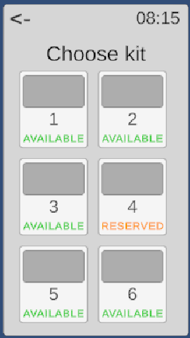
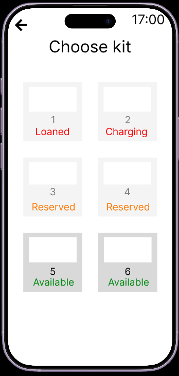
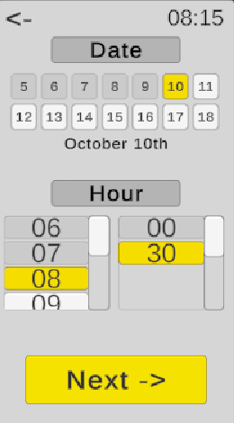
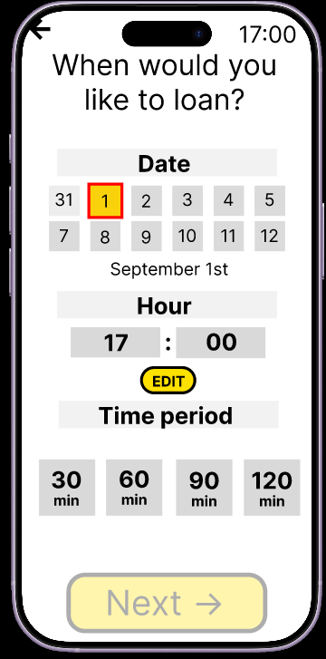
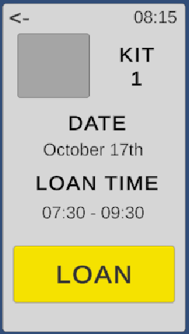
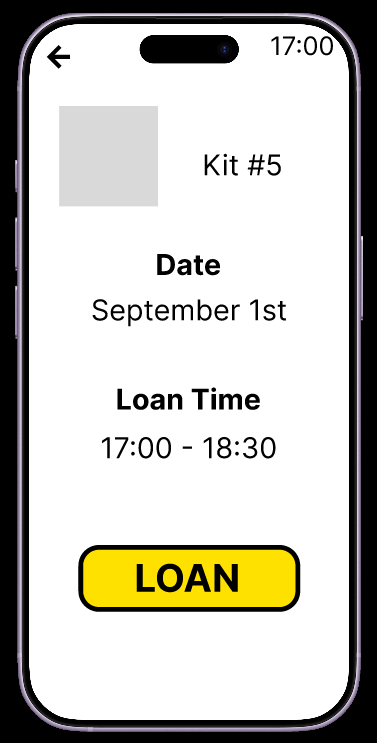

**Design**

**BRUNO PALACIOS CACHO & EMILIO CASTELLANOS CORTEZ**

- Law of Similarity: As species we associate red and similar tones to something blocked while green is an indicator to continue. This was used in the text of “available” marked as green, “Loaned” marked as orange and “Reserved” marked as red to indicate in an easier way to the user the state of the kit.

	 

This wasn’t changed in the usable program because the users who participated in the test had no trouble understanding this part of the design

- Affordance Law: The properties of an element suggest their usage. In this case when we make the color of a blocked button more gray, the user can induce that he doesn’t has to click it.

	 

In the prototype, most buttons used a grayscale color scheme, with a slight change in shade for those that were disabled.

During testing, we noticed that this caused confusion among users, so we decided to reserve the gray color exclusively for disabled buttons.

- Contrast Law: The elements that contrast in colorimetry in an interface captures the users attention almost immediately, so it is usually used in favor to indicate the user where he or she has to go without using words.  
  We use the color yellow and a fairly large size for each button that takes you to the next tab (or the next stage of the journey), so that users associate that design with moving forward  
     
  This was planned since the FIGMA prototype and wasn’t changed.

