**Testing**

**BRUNO PALACIOS CACHO & EMILIO CASTELLANOS CORTEZ**

**Test cases**

Test 01: Checkout

1. User loans into the Kiosk.   
   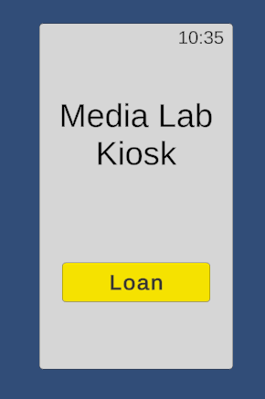
2. User chooses day and hour  
   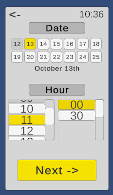
3. User chooses the period of time for use  
   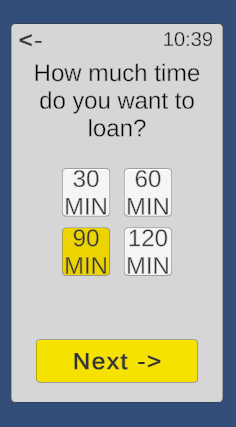  
4. User selects a kit for the menu  
   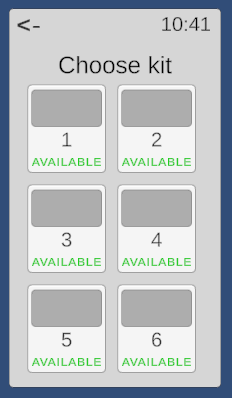
5. User reads the specifications of the kit  
   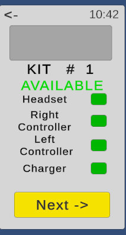  
6. User makes the confirmation  
   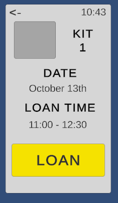 
7. User receives his/her ticket  
   Expected Result: User can exit the page and add the product to his/her calendar  
   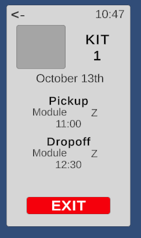
   Actual Result: There is no “add to calendar” button  
   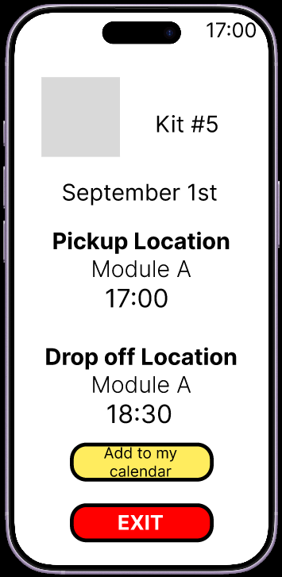

Test 02: No availability

1. User loans into the kiosk  
2. User chooses day and hour  
3. User chooses the period of time for use  
4. User reads the message of unavailability  
   Expected result: The message gives the option to redirect the user to the nearest kit available  
   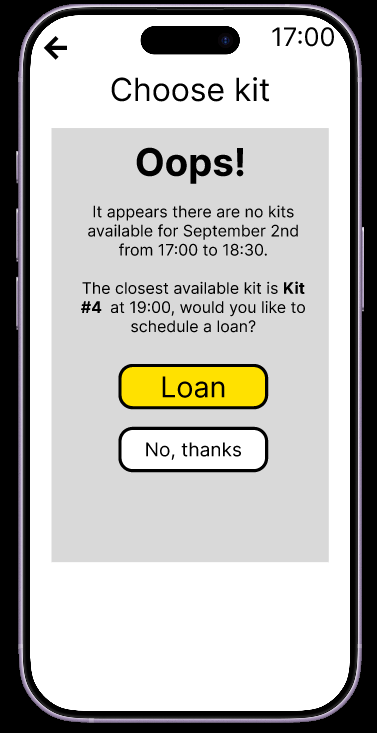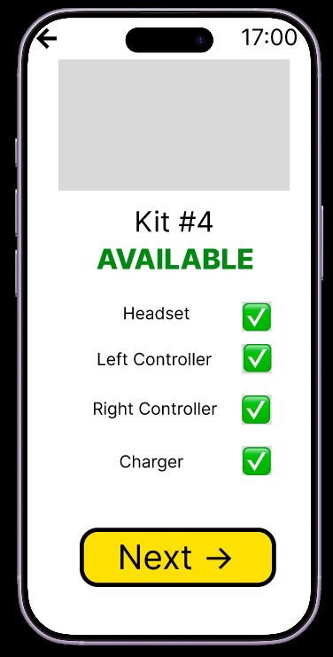
   Actual result: There is a message that redirects the user to the calendar  
   
5. User selects another date, and continues normally  
   

Test 03: Invalid Kit

1. User loans into the Kiosk.   
2. User chooses day and hour  
3. User chooses the period of time for use  
4. User selects a kit for the menu  
5. An advice pops out to let the user know that he can’t reserve that kit  
   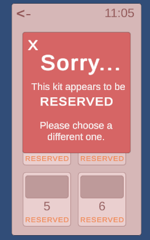

Test 04: Editing choices

1. User loans into the Kiosk.   
2. User chooses day and hour  
3. User chooses the period of time for use  
4. User selects a kit for the menu  
5. At any time, the user can go back using the arrow. The options he chose remain saved

Test 05: Save data after restart

1. Reservation at October 14th at 13:30  
   
2. Select period for 90 minutes  
   
3. Chooses Kit 1, makes reservation and leaves  
   ![image17]!(t5_03.png)[image18](t5_04.png)
4. Same date and period of time menu  
   

Test 06: Scenario Reset

1. Select R at any time  
2. Click on “Reset”  
3. Select R again to close

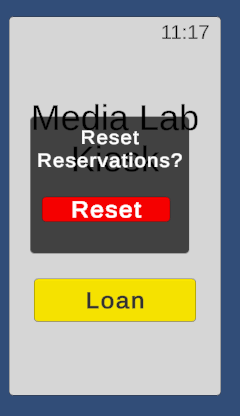

**Users tested**

User 01

—-SCENARIO A—-

Time: 56.35 seconds

User 's observations: “No está funcionando”, “Esta muy pequeño”, “¿Esto es la hora?”

Errors: It doesn't recognize what is the section of the time selection. She Clicks on a day that's grayed out; she doesn't realize that and tries to click “Next” for a couple of times

Help: It is indicated to the user the hour section

—-SCENARIO B—-

Time: 28.52 seconds

User 's observations: “Oye pero no hay nada”

Errors: She stares at the “No kits for this date” window for a couple of seconds. She returns to the date reservation and chooses an hour 30 minutes earlier but it doesn’t work. She ends choosing same day, but two hours later

Help: No help provided

User 02

—-SCENARIO A—-

Time: 40.68 seconds

User 's observations: “¿Porqué es tan pequeño?”

Errors: He clicks at a button that is unclickable, and in response to the non reaction of the button he tries to click it a couple of times. He stares at the calendar for a couple of seconds

Help: No help provided

—-SCENARIO B—-

Time: 47.36 seconds

User 's observations: Oye no se ve nada

Errors: He makes the reservation quickly, choosing the time and the day, but he stares at the  text that tells him that there is no kit available, he moves his face closer to the screen. He chooses 30 minutes earlier but the result is the same. He chooses 30 minutes before and, again, the result is the same. 

Help: No help provided

User 02

—-SCENARIO A—-

Time: 38.58 seconds

User 's observations: “Creí que seleccionando dos días saldría un rango o algo así”

Errors: He selects different days. Then he selects the minute of the hour, but not the hour; he tries to click “Next” 

Help: No help provided

—-SCENARIO B—-

Time: 21.23 seconds

User 's observations: None

Errors: He makes the reservation quickly and changes the hour in the same day when he realizes that there are no kits, but, when the list is displayed for the new date, he selects the only kit that is unavailable

Help: No help provided

**Usability problems checked and fixed:**

This changes where made previous at the experimentation with the unity program in response of the experimentations made with the figma earlier:

1. Blocked Buttons gray: The different in tone between the blocked buttons and the available buttons was too low, so we decided to make the blocked buttons full gray and the other ones white or yellow  
2. Period of time in another page: The day, hour and the period of time for use were in the same page, we noticed that the users tend to spend too much time reading the reservation part, so we decided to separate it in order to avoid overcharging in the design.